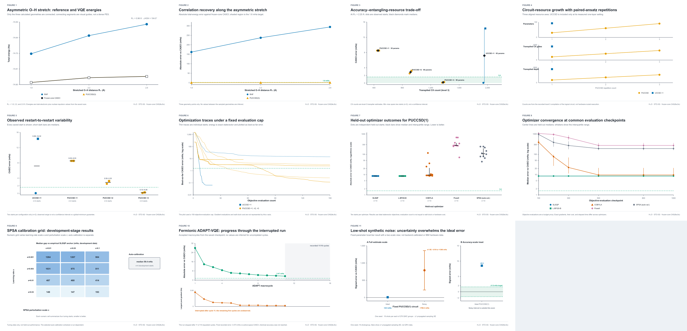

# Quanta H₂O VQE: asymmetric bond stretching with adaptive and paired ansätze

**Track:** VQE for Chemistry & Materials  
**Scientific question:** How do chemistry-inspired VQE ansätze trade accuracy against circuit resources when one O–H bond in water is stretched?  
**Model:** H₂O in STO-3G at H–O–H = 104.5°, with one O–H bond fixed at 0.96 Å and the second varied. The main comparison is at R₂ = 2.20 Å.  
**Team:** Quanta (project label; confirm official team name before final submission).

> Results below are classical calculations unless explicitly identified as noisy simulation. No completed IBM QPU result is archived in this repository yet. The report will be updated when the hardware job data are available.

## At a glance

- Build the molecular Hamiltonian from the stated geometry using PySCF; do not load a hand-written Pauli Hamiltonian.
- Verify the frozen-core CAS(8e,6o) Hamiltonian against an independent mapped exact solve before running VQE.
- Compare UCCSD and paired UCCSD (PUCCSD) ansätze under the same small evaluation budget, and inspect their optimized circuit resources.
- Track a warm-start PUCCSD(3) asymmetric stretch and test several classical optimizers on PUCCSD(1).
- Provide an end-to-end notebook, reproducible command-line workflows, raw machine-readable outputs, and 11 source-linked scientific figures.

## Main findings so far

At R₂ = 2.20 Å, the reference chain gives RHF = −74.623892380736 Ha, frozen-core CASCI(8e,6o) = −74.860977098519 Ha, and all-electron STO-3G FCI = −74.861014224915 Ha. The independent exact solve of the mapped active-space Hamiltonian agrees with CASCI. **VQE errors and the 1.6 mHa chemical-accuracy threshold in this project are measured relative to active-space CASCI**, not to full-molecule FCI.

The matched ansatz resource pilot used two starts per setting and a 150-objective-evaluation cap. CX counts are logical-circuit counts after level-3 transpilation, not routed QPU counts.

| Ansatz | Parameters | CX | Median absolute error | Best observed error | Within 1.6 mHa |
|---|---:|---:|---:|---:|---:|
| UCCSD ×1 | 92 | 1,955 | 7.193 mHa | 0.064 mHa | 1/2 |
| PUCCSD ×1 | 30 | 458 | 8.524 mHa | 8.518 mHa | 0/2 |
| PUCCSD ×2 | 60 | 916 | 2.876 mHa | 2.517 mHa | 0/2 |
| PUCCSD ×3 | 90 | 1,374 | 0.187 mHa | 0.115 mHa | 2/2 |

These are small pilot samples, not statistical guarantees. The deeper paired circuit lowered the observed error substantially in this setup, at the cost of more parameters and entangling gates. A separate completed PUCCSD×3 SLSQP run reached −74.860885521062 Ha, 0.0916 mHa above the active-space CASCI reference. Its saved 90-parameter vector is `results/ansatz/puccsd3_params.json`.

A three-point warm-start scan produced absolute errors of 0.398, 0.290, and 0.554 mHa at R₂ = 1.80, 2.20, and 2.60 Å. It is a three-point demonstration, not a resolved potential-energy curve. The fermionic ADAPT-VQE run requested 16 macrocycles but only has archived progress through cycle 11; its last recorded error was 3.473 mHa. It is incomplete and did not reach the target.

The held-out optimizer comparison is for PUCCSD×1 only. Median errors were 8.518 mHa (L-BFGS-B), 8.534 mHa (SLSQP), 9.574 mHa (COBYLA), 273.682 mHa (Powell), and 106.586 mHa (selected SPSA). This does not establish a universal optimizer ranking or predict performance on PUCCSD×3. Full settings and per-run data are in `results/optimizers/systematic-optimizer-study/`.

One deliberately low-shot synthetic noisy estimate is included as a pipeline demonstration: 16 shots per each of 276 qubit-wise-commuting groups, one seed, 4,416 nominal shots total. Its energy error was +789.3 mHa with a propagated sampling standard error of 570.4 mHa. The uncertainty is enormous; this result is useful to show why the measurement budget matters, not to claim useful chemical accuracy. It is not IBM-calibrated noise and not QPU data.

## Figures

All figures are generated from archived CSV/JSON results; the captions record the source and limitations. SVGs are editable vector originals; PNG previews are 4200 × 2700 px. Open the [HTML gallery](results/publication_figures/index.html) or the [figure catalog](results/publication_figures/FIGURE_CATALOG.md).



Selected figures:

1. [Asymmetric-stretch energies](results/publication_figures/fig01_asymmetric_stretch_energy.png)
2. [Error relative to active-space CASCI along the scan](results/publication_figures/fig02_scan_error_vs_casci.png)
3. [Accuracy versus entangling-gate resources](results/publication_figures/fig03_accuracy_resource_pareto.png)
4. [Paired-ansatz circuit-resource scaling](results/publication_figures/fig04_ansatz_resource_scaling.png)
5. [Restart variability](results/publication_figures/fig05_ansatz_restart_spread.png)
6. [Ansatz optimization traces](results/publication_figures/fig06_ansatz_convergence.png)
7. [Held-out optimizer outcomes](results/publication_figures/fig07_optimizer_outcomes.png)
8. [Optimizer budget convergence](results/publication_figures/fig08_optimizer_budget_convergence.png)
9. [SPSA development-grid tuning](results/publication_figures/fig09_spsa_tuning_heatmap.png)
10. [Partial fermionic ADAPT-VQE progress](results/publication_figures/fig10_adapt_macrocycle_progress.png)
11. [Low-shot synthetic noise with uncertainty](results/publication_figures/fig11_synthetic_noise_uncertainty.png)

## Scientific workflow

1. **Define geometry and references.** PySCF builds the water molecule with the chosen O–H distance and fixed angle, runs RHF, all-electron STO-3G FCI, and frozen-core CASCI(8e,6o).
2. **Construct and cross-check the active Hamiltonian.** The six valence spatial orbitals contain eight active electrons. The twelve active spin orbitals are mapped with particle-aware parity reduction to ten qubits. CASCI and an independent exact mapped solve are compared before VQE.
3. **Prepare the reference state.** UCCSD, PUCCSD, and fermionic ADAPT circuits start from the active-space Hartree–Fock state.
4. **Optimize and measure resources.** Ideal statevector expectations are optimized classically. Repeated ansatz blocks, restarts, and optimizers are compared; objective calls, parameters, depth, and transpiled CX are recorded where available.
5. **Audit geometry and noise sensitivity.** PUCCSD(3) is warm-started across a sparse stretch scan. A separate finite-shot simulator example reports uncertainty. IBM QPU measurement is a distinct fixed-parameter experiment and must be reported separately.

### Reproduce

The first code cell of the submission notebook installs the project and its declared dependencies. On Colab or a Linux/WSL environment, clone the public repository, install, and launch Jupyter:

```bash
git clone https://github.com/Athleity/Quanta-H2O_VQE-.git
cd Quanta-H2O_VQE-
python -m pip install --prefer-binary -e .
```

For a core-reference install in WSL, use `python -m pip install --prefer-binary -r requirements-wsl.txt`. PySCF is not supported as a native Windows build; use Linux, WSL, or Colab.

Run the reference calculation and one VQE example:

```bash
h2o-vqe --reference-only --stretched-oh 2.20 --output results/references/reproduce-r2.20
h2o-vqe --methods puccsd --ansatz-reps 3 --optimizer slsqp \
  --restarts 1 --seed 20261023 --maxiter 100 \
  --output results/ansatz/reproduce-puccsd3-r2.20
```

Regenerate figures from saved experiment outputs with:

```bash
python scripts/make_publication_figures.py
```

The full user-facing workflow is in [`notebooks/h2o_asymmetric_stretch.ipynb`](notebooks/h2o_asymmetric_stretch.ipynb). The primary implementation is in `src/h2o_vqe/engine.py`; `h2o_vqe.py` is a compatibility launcher. See [`PROJECT_MAP.md`](PROJECT_MAP.md), [`results/README.md`](results/README.md), and [`docs/RESEARCH.md`](docs/RESEARCH.md).

## IBM Quantum status

`src/h2o_vqe/ibm_qpu.py` supports a dry run and explicit submission of a saved circuit/parameter vector using IBM Runtime. This workflow evaluates a fixed variational state; it does not optimize parameters on the QPU. No completed hardware record is currently archived here. When a result is available, record the backend and calibration time, job ID, transpiled circuit/layout, shots or precision, mitigation settings, measured energy, uncertainty, and ideal reference in `results/hardware/`. Do not commit API keys, tokens, or private account data.

## Project layout

```text
src/h2o_vqe/               maintained chemistry, VQE, noise, and IBM code
scripts/                    experiment orchestration and figure generation
notebooks/                  runnable hackathon submission notebook
docs/                       research review and project-status snapshot
results/references/          RHF, FCI, CASCI, mapping, and orbital checks
results/ansatz/              ansatz comparisons and saved parameter vector
results/scans/               asymmetric O–H scan data
results/optimizers/          optimizer calibration and held-out study
results/noisy-demo/          synthetic finite-shot demonstration
results/publication_figures/ editable figures, previews, gallery, and captions
results/hardware/            reserved for completed QPU outputs
```

## Team

**Project/team name:** Quanta (repository label; confirm official team name before final report).

| Member | Institution | Department / field | Career level |
|---|---|---|---|
| Priyansh Bhavsar | IIT Jodhpur | Physics | Bachelor’s student |
| Mohammed Hasan Iqbal | IIT Bombay | Not provided | Not provided |
| Yahya Mohammed | Nile University | Computer Science | Not provided |
| Donia Mohammed | Zagazig University | Chemistry and Computer Science | Not provided |

Missing affiliations and career levels are intentionally marked “Not provided”; confirm them with teammates before final submission. The category is VQE for Chemistry & Materials.

## Limitations and interpretation

- STO-3G and frozen-core CAS(8e,6o) are model choices. The active-space result is not the exact ground energy of the complete basis-set water molecule.
- The bond scan contains three geometries; no interpolation is claimed as computed data.
- Resource pilot and restart statistics are small. Counts are compiled logical-circuit metrics, not device-routed costs.
- Statevector optimizer objective-call counts do not represent equal wall time, gradient cost, shots, or hardware workload.
- Noisy estimates may fall below the ideal variational energy through sampling fluctuation; they must be interpreted with uncertainty.
- ADAPT is recorded only through 11 of 16 requested cycles.
- No completed IBM hardware result is included yet; update the figures, status, and final report only from archived job results.

## References

A broader bibliography with methodology notes and source links is in [`docs/RESEARCH.md`](docs/RESEARCH.md). Key implementation and method references:

- Bian et al., [Quantum computing methods for electronic states of the water molecule](https://arxiv.org/abs/1804.05453), *Molecular Physics* (2019).
- Lee et al., [Generalized Unitary Coupled Cluster Wavefunctions for Quantum Computation](https://doi.org/10.1021/acs.jctc.8b01004), *J. Chem. Theory Comput.* 15, 311–324 (2019). PUCCSD is not asserted to reproduce every k-UpCCGSD construction.
- Grimsley et al., [An adaptive variational algorithm for exact molecular simulations on a quantum computer](https://doi.org/10.1038/s41467-019-10988-2), *Nature Communications* 10, 3007 (2019).
- [Qiskit Nature PUCCSD API](https://qiskit-community.github.io/qiskit-nature/stubs/qiskit_nature.second_q.circuit.library.PUCCSD.html), [UCC/VQE guide](https://qiskit-community.github.io/qiskit-nature/howtos/vqe_ucc.html), and [ADAPT-VQE guide](https://qiskit-community.github.io/qiskit-nature/howtos/adapt_vqe.html).
- Nature, [Preparing figures: specifications and accessibility](https://research-figure-guide.nature.com/figures/preparing-figures-our-specifications/).
