# Quanta: High-accuracy VQE simulations of stretched water

**A reproducible quantum-chemistry study demonstrating sub-millihartree errors in noiseless PUCCSD ×3 simulations across three stretched-water geometries, alongside dedicated circuit, measurement, and IBM hardware analyses.**

**Submission category: Champion**

## VQE circuit figures

The excitation-pool figure shows the operators available to the ansatz. The full-depth figure shows how the complete circuit is scheduled across its layers.

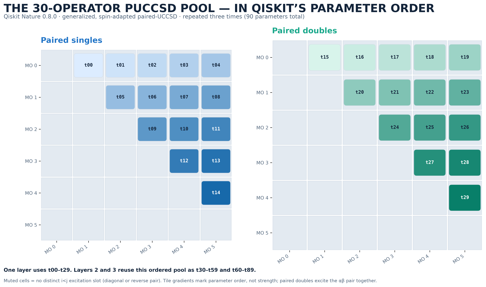

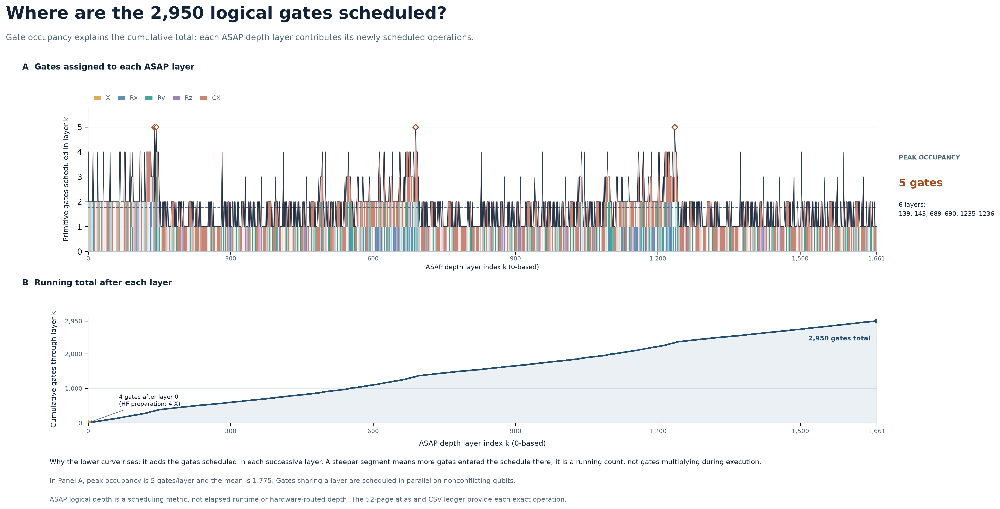

[Browse all circuit figures](results/publication_figures/circuit_figures/)

## Interactive H₂O electron-density viewer

[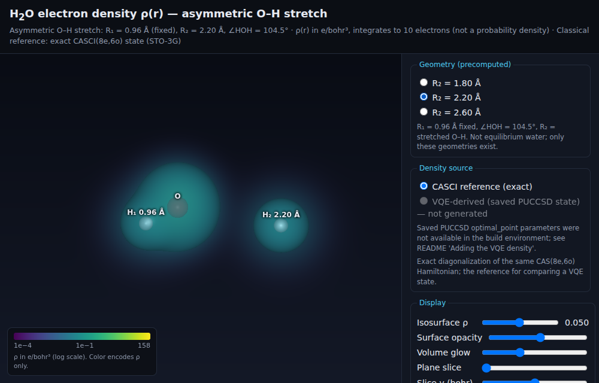](https://athleity.github.io/Quanta-H2O_VQE-/visualization/h2o_density/web/)

[Open the live 3D viewer](https://athleity.github.io/Quanta-H2O_VQE-/visualization/h2o_density/web/)

The viewer brings the study’s classical CASCI electron densities to life in an interactive 3D display, with the calculation method clearly identified.

This repository studies a small but challenging quantum chemistry problem: a water molecule with one O–H bond stretched away from its usual length. The project asks three related questions:

1. **Can a variational quantum circuit represent a correlated molecular state accurately in an ideal simulation?**
2. **What happens to an energy estimate when measurements use a limited number of shots?**
3. **What do real quantum hardware measurements report for selected circuits and observables?**

Together, these experiments give a clear, reproducible view of VQE accuracy, measurement uncertainty, and real-device reference-state behavior. Each result is tied to its stated state, estimator, and reference so readers can follow how the evidence was produced.

> **The central finding:** At R₂ = 2.20 Å, the three-repetition particle-number-conserving unitary coupled-cluster ansatz (PUCCSD ×3) achieved a **0.187 millihartree (mHa) median error** and a **0.115 mHa best observed error** in the two-start noiseless pilot, relative to the active-space CASCI reference. A separate, longer optimization reached **0.001520 mHa**. Across the three calculated stretched-bond geometries, PUCCSD ×3 recorded errors of **0.398, 0.290, and 0.554 mHa**, each below the 1.6 mHa accuracy threshold used in this study. These results demonstrate high accuracy for the stated model. Finite-shot and IBM hardware findings are presented in their own sections, with their scope clearly stated.

## Start here

If you are new to the project, this is a useful reading order:

1. Read **What the project does** to understand the three experiments.
2. Look at the **results overview** figure.
3. Read **The molecular system and geometry** to understand the molecule being calculated.
4. Read **Reference energies** before interpreting any reported VQE error.
5. Compare the **noiseless simulation**, **finite-shot simulation**, and **hardware** sections separately.
6. Use the figure gallery and reproducibility instructions to inspect or rerun the work.

## What the project does

A molecular calculation starts with a model of the molecule: its atomic positions, the mathematical description of its orbitals, and the electrons that are allowed to move. A calculation then estimates the molecule’s energy.

This project uses a classical electronic-structure calculation to establish reference energies. It also uses variational quantum circuits as flexible trial descriptions of the electrons. A classical optimizer adjusts circuit parameters to search for a lower-energy state.

The project contains three different evidence layers:

### 1. Noiseless VQE simulation: circuit and optimizer behavior

The ansatz and optimizer experiments use ideal statevector calculations. The simulator calculates each circuit’s energy without finite-shot sampling fluctuations or physical device errors.

These experiments measure how well a chosen circuit and optimizer find a low-energy state under the stated model and evaluation budget. They are **simulation results**, even when the circuit is designed for quantum hardware.

### 2. Finite-shot simulation: uncertainty from limited measurements

A dedicated experiment estimates one fixed circuit with a deliberately limited number of simulated measurement shots per group. It quantifies how measurement sampling affects an energy estimate and compares that result with the same circuit’s exact statevector value.

This synthetic Aer experiment isolates the finite-shot measurement question, complementing the separate IBM hardware reference-state study.

### 3. IBM quantum hardware: measurements of a reference state

Four IBM jobs measured the Hartree–Fock reference state with compact circuits containing four X gates and zero entangling gates. Together, they provide job-specific energy offsets and statistical standard errors across several hardware measurement procedures.

These jobs provide a real-device baseline for the project’s hardware layer. Their measured state and role are identified separately in the limitations section.

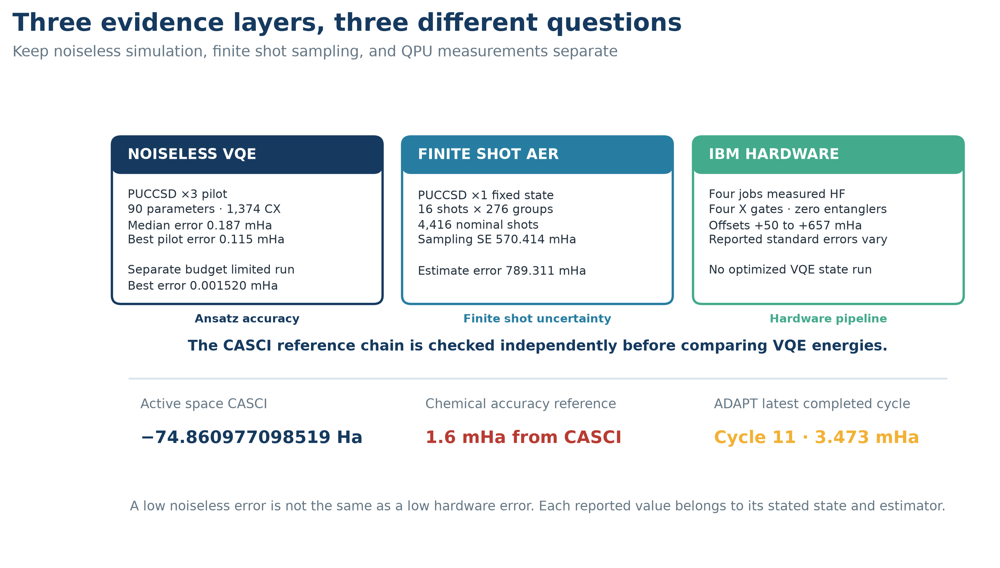

*The overview highlights the complementary strengths of the three evidence layers: ideal-state accuracy, finite-shot measurement analysis, and real-device reference-state data.*

## The interactive H₂O electron-density viewer

[Open the live interactive electron-density viewer](https://athleity.github.io/Quanta-H2O_VQE-/visualization/h2o_density/web/)

The viewer displays a three-dimensional electron-density field for water. You can rotate the molecule, zoom in and out, and pan the view. It includes density grids for the three stretched-bond geometries used in the project.

**The viewer displays density grids from classical CASCI calculations.** This provides an interactive view of the project’s validated reference calculation, with each geometry and method labeled. A density reconstructed from the optimized VQE state would be a separate analysis requiring the corresponding state or reduced density matrix and molecular-orbital mapping.

The viewer adds a useful visual companion to the energy study: readers can explore how the classical reference density changes across the saved geometries while seeing exactly which method produced it.

### Run the viewer from a local checkout

From the repository root, start a local web server:

    python -m http.server 8000

Then open this address in your browser:

    http://localhost:8000/visualization/h2o_density/web/

A local server allows the page to load the density-grid files. Opening the HTML file directly from the file system may block those data requests. The three density grids total roughly **10 MB**, so initial loading time depends on your connection and device. Rotation and zooming happen in the browser.

## The molecular system and geometry

The molecule is neutral water, H₂O, with a singlet electronic state. One O–H bond remains fixed while the other is stretched. This is called an **asymmetric stretch**.

| Geometry setting | Value |
|---|---:|
| Molecule | H₂O |
| Fixed O–H bond, R₁ | 0.96 Å |
| H–O–H angle | 104.5° |
| Stretched O–H bond, R₂ | 1.80, 2.20, or 2.60 Å |
| Total charge | 0 |
| Spin | 0 |

The oxygen atom is at the coordinate origin. One hydrogen lies on the positive z-axis. The other is placed in the x–z plane so that its distance from oxygen and the H–O–H angle match the chosen geometry.

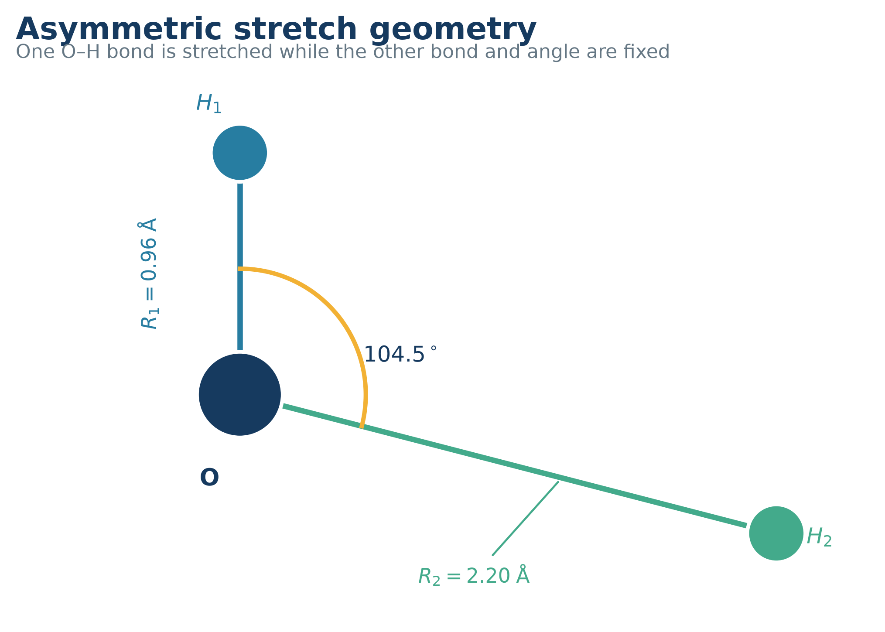

*The line segments connect only the three calculated geometries. They are visual guides; no dense potential-energy curve or intermediate values are implied.*

### Why stretch a bond?

Stretching a bond makes electron correlation more visible: multiple electron arrangements can contribute, giving variational methods a meaningful test beyond the ordinary bond-length regime.

That makes stretched water a focused benchmark for comparing ansätze and optimization strategies. The compact basis and active space keep the calculations tractable, and the conclusions are reported for that clearly defined model.

## Basis set and active space

The calculations use the **STO-3G basis set**, a compact collection of mathematical functions for representing molecular orbitals. Its modest size makes the full workflow reproducible and suitable for a detailed circuit study; the resulting chemical conclusions are scoped to this basis, as described under limitations.

The VQE calculation uses **CAS(8e,6o)**:

- **8 electrons** are treated as active electrons that can rearrange among the selected orbitals.
- **6 spatial orbitals** are included in the active calculation.
- The two electrons in the lowest core orbital are frozen in that orbital.

In the full STO-3G model of neutral water, there are 10 electrons. Freezing the core leaves 8 electrons in the active space. This approximation reduces the size of the quantum problem while retaining the valence-electron behavior that is the focus of this study.

“Active space” does not mean that the other orbitals do not exist. It means their occupations are held fixed for the active-space calculation. The choice of active space is part of the model and affects the reference energy.

## Energy references: what the errors are measured against

An energy error needs a clearly stated reference. The main VQE errors in this project are measured against **frozen-core CASCI(8e,6o)** at the same geometry.

At the central geometry, where R₂ = **2.20 Å**, the saved energies are:

| Method | Energy at R₂ = 2.20 Å |
|---|---:|
| Restricted Hartree–Fock (RHF) | −74.623892380736 Ha |
| Frozen-core CASCI(8e,6o) | −74.860977098519 Ha |
| All-electron STO-3G FCI | −74.861014224915 Ha |

These methods describe different spaces of possible electron arrangements:

- **RHF** uses a single mean-field electron configuration with paired electrons.
- **CASCI** finds the lowest energy within the chosen active orbitals while keeping the frozen core fixed.
- **FCI** finds the lowest energy in the full STO-3G orbital space, without the same frozen-core restriction.

The close CASCI and FCI values provide a useful cross-check on the energy scale. VQE errors are reported against CASCI because that is the reference for the active-space quantum problem; the README states the reference explicitly wherever an error is discussed.

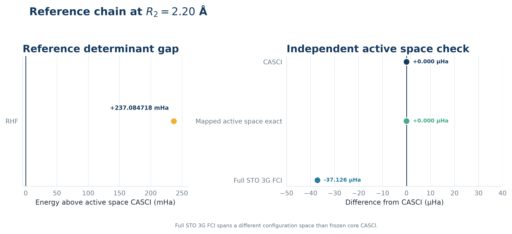

*The reference figure shows the classical and mapped checks used to establish the energy scale. The remainder of the README states which reference applies to each result.*

## How a VQE calculation works

A variational quantum eigensolver combines a parameterized quantum circuit with a classical search:

1. The circuit prepares a trial state for the molecule’s electrons.
2. The Hamiltonian, which encodes the modeled molecular energy, is measured for that state.
3. A classical optimizer uses the measured energy to choose new circuit parameters.
4. The process repeats, seeking a lower energy.

The circuit pattern is called an **ansatz**. Its adjustable values are called **parameters**. A more expressive ansatz can represent more complex electron correlation, but it can also require more gates and make optimization harder.

In an ideal statevector simulation, the energy expectation is evaluated without finite-shot sampling. That lets the project study ansatz and optimizer behavior while isolating the effects of limited measurements and physical hardware.

## Workflow

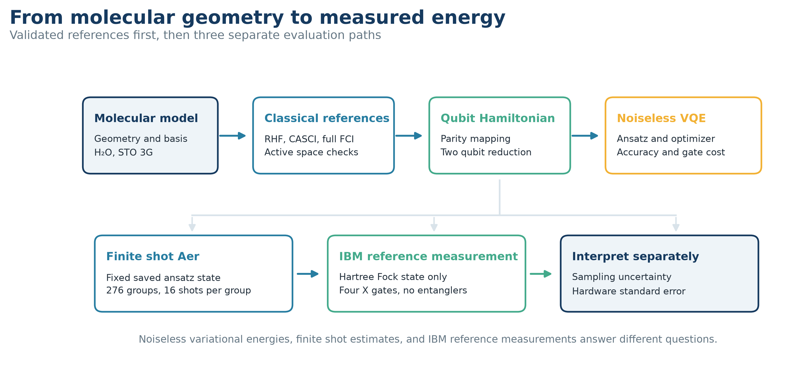

1. Set the molecular geometry and electronic-structure model.
2. Calculate classical energy references, including the active-space CASCI value.
3. Build trial circuits with specified ansätze and repetition counts.
4. Optimize their parameters in noiseless simulation.
5. Compare energy errors, optimizer behavior, and logical circuit resources.
6. Run a separate finite-shot simulation for a fixed circuit.
7. Submit separate Hartree–Fock reference-state measurement jobs to IBM hardware.
8. Interpret each result using its own state, method, measurement settings, and reference.
## Noiseless VQE results

The ansatz and optimizer comparisons use **ideal statevector simulation**. In this setting, the simulator calculates the energy expectation directly from the represented quantum state. The result has no finite-shot sampling error and no physical quantum-device error.

“Noiseless” describes the simulation, not the whole scientific model. The basis set, active space, ansatz, optimizer, initial parameters, and evaluation budget still affect the answer.

### What was compared

The pilot compared four circuit configurations at the central geometry, R₂ = 2.20 Å:

- UCCSD with one repetition
- PUCCSD with one repetition
- PUCCSD with two repetitions
- PUCCSD with three repetitions

A repetition adds another layer of the ansatz. In general, more repetitions give a circuit more flexibility to describe electron correlation. They also increase the number of parameters and gates.

Each configuration had **two optimizer starts**, with a limit of **150 objective evaluations per start**. An objective evaluation is one energy value provided to the optimizer. It is a convenient measure of search effort, but it is not the same as elapsed runtime or quantum-hardware cost.

### Pilot results

| Ansatz configuration | Parameters | Level-3 logical CX count | Median error | Best observed error | Starts below 1.6 mHa |
|---|---:|---:|---:|---:|---:|
| UCCSD ×1 | 92 | 1,955 | 7.193 mHa | 0.064 mHa | 1 of 2 |
| PUCCSD ×1 | 30 | 458 | 8.524 mHa | 8.518 mHa | 0 of 2 |
| PUCCSD ×2 | 60 | 916 | 2.876 mHa | 2.517 mHa | 0 of 2 |
| PUCCSD ×3 | 90 | 1,374 | 0.187 mHa | 0.115 mHa | 2 of 2 |

The median summarizes the two recorded starts, while “best observed” identifies the lowest error among them. Together, these metrics give a transparent view of the pilot outcomes; the sample size and run settings are documented so readers can judge their scope.

In this pilot, increasing the PUCCSD repetition count improved the observed median error. PUCCSD ×3 used more parameters and logical CX gates than PUCCSD ×1, but it also represented the correlated state more accurately under the pilot’s fixed evaluation cap.

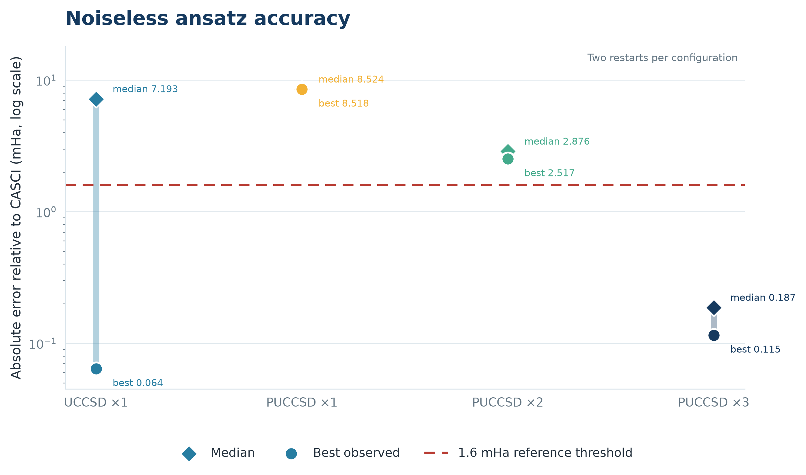

*The plotted results come from the noiseless pilot. The 1.6 mHa reference is an energy-error target, not a hardware-performance claim.*

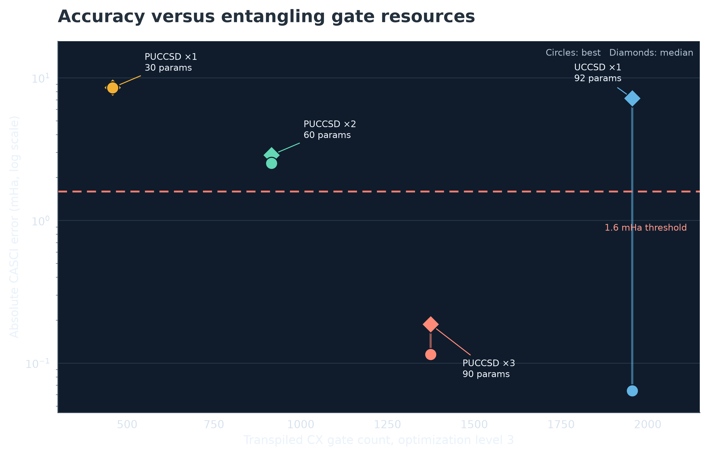

*CX counts are level-3 logical transpiler estimates. They are not counts of gates after routing to a particular quantum processor.*

### A separate, longer PUCCSD ×3 optimization

The project also records a separate PUCCSD ×3 SLSQP run with a larger optimization budget. It reported:

| Quantity | Recorded result |
|---|---:|
| Energy | −74.860975578262 Ha |
| Frozen-core CASCI reference | −74.860977098519 Ha |
| Absolute error | 0.001520 mHa |
| Ansatz parameters | 90 |
| Objective-evaluation budget | 1,500 |

This separate high-budget run shows that a longer search found a very low-error point for this setup. Its 1,500-evaluation budget and run identity are reported explicitly alongside the shorter pilot, making the two results easy to distinguish and reproduce.

The figure below displays saved high-budget trial results. The number of trials is small, so the figure should be read as a record of those runs rather than a large statistical study.

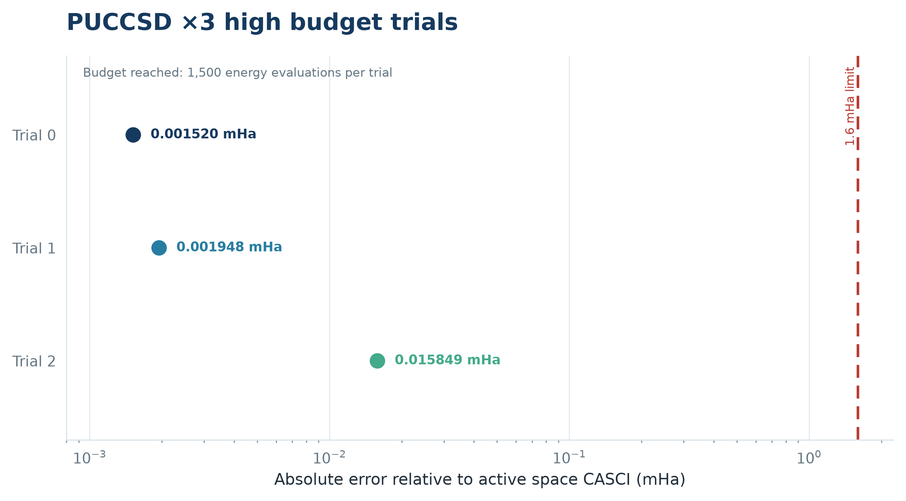

### Interpreting the accuracy target

The project uses **1.6 mHa** as the chemical-accuracy reference threshold. One millihartree is one thousandth of a Hartree, so 1.6 mHa is 0.0016 Ha.

In the pilot table, the best UCCSD ×1 start and both PUCCSD ×3 starts were below this threshold. The table also shows how the deeper PUCCSD ×3 circuit improved on the shallower PUCCSD settings under the same pilot budget. These results are reported for the saved noiseless runs at the stated geometry and model.

## Accuracy across the stretched-bond geometries

A single geometry can hide how an ansatz behaves as the molecular structure changes. The project therefore compares PUCCSD ×3 with CASCI at three stretched O–H bond lengths.

| Stretched bond R₂ | CASCI energy | PUCCSD ×3 energy | Absolute error |
|---:|---:|---:|---:|
| 1.80 Å | −74.887678538893 Ha | −74.887280139717 Ha | 0.398 mHa |
| 2.20 Å | −74.860977098519 Ha | −74.860687456423 Ha | 0.290 mHa |
| 2.60 Å | −74.853880734062 Ha | −74.853326368035 Ha | 0.554 mHa |

All three saved errors are below 1.6 mHa. This supports a limited conclusion: for these three calculated points, with this basis, active space, ansatz, and reference, the saved noiseless PUCCSD ×3 energies were within the stated threshold.

The three sampled geometries show consistent sub-1.6 mHa PUCCSD ×3 errors across the tested stretch range. Connecting lines guide the eye between calculated points; the reported values remain the three saved geometries.

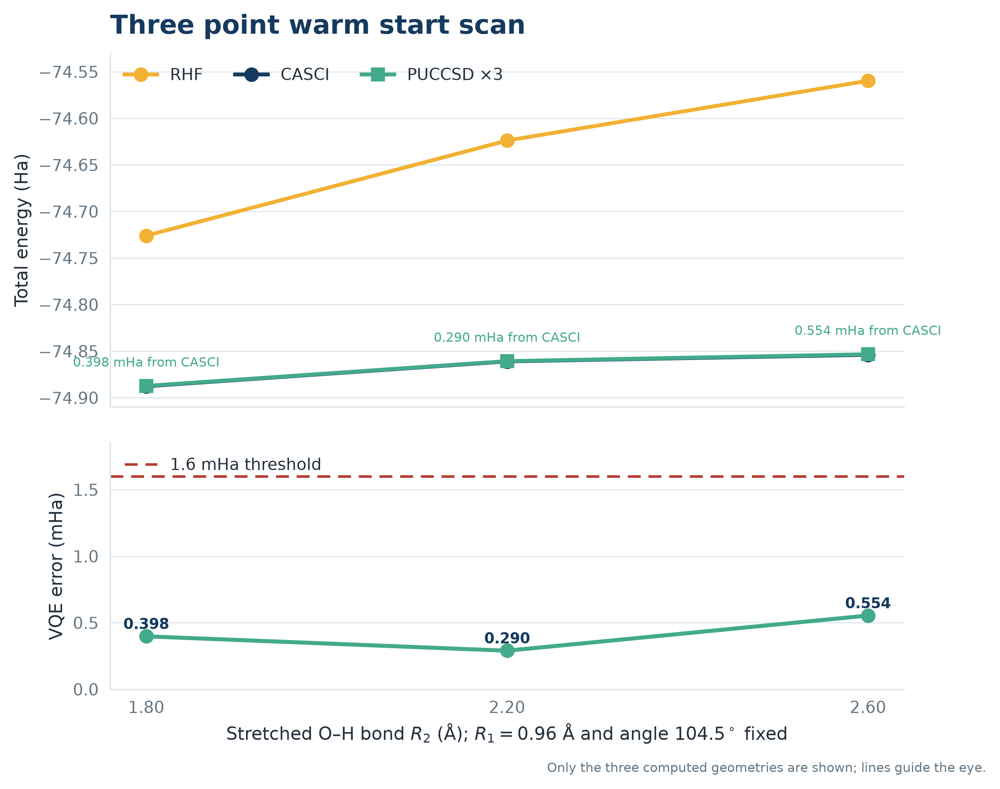

## Reference and orbital consistency checks

VQE errors are only meaningful when the trial energy and the reference energy use the same molecular geometry and compatible definitions of orbitals, active space, and Hamiltonian. A mismatch in any of these can make an apparent energy error misleading.

The project independently checks the active-space reference against a mapped Hamiltonian and audits orbital conventions. Agreement between these checks supports the internal consistency of the saved calculation chain; the chemical scope of the basis and active space is stated in the limitations section.

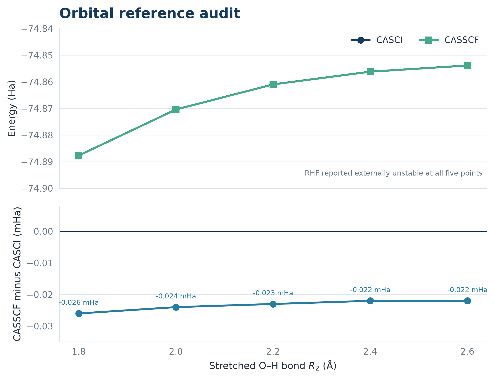

## Optimizers: results depend on the search method

The optimizer comparison tested five classical optimization methods on the held-out PUCCSD ×1 task. The reported value is the median absolute error for the corresponding optimizer’s saved starts.

| Optimizer | Median absolute error |
|---|---:|
| L-BFGS-B | 8.518 mHa |
| SLSQP | 8.534 mHa |
| COBYLA | 9.574 mHa |
| SPSA | 106.586 mHa |
| Powell | 273.682 mHa |

On this held-out PUCCSD ×1 task, L-BFGS-B and SLSQP produced the lowest reported medians. The comparison gives a concrete, reproducible view of optimizer behavior under a shared task definition; the table records the conditions needed to interpret the ranking.

The objective-evaluation count is a budget proxy. It does not account for all differences in gradient calculations, circuit executions, runtime, or hardware cost between optimizers.

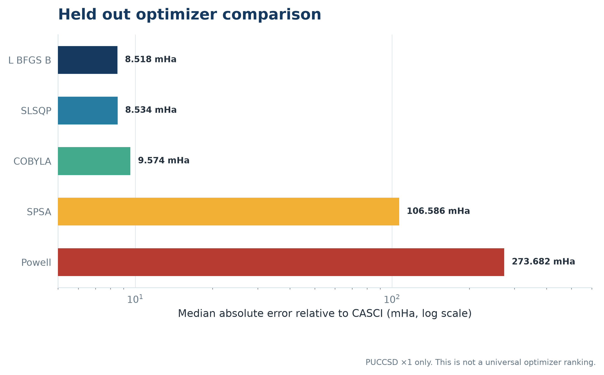

## ADAPT-VQE: recorded progress through an interrupted run

ADAPT-VQE builds a circuit incrementally. At each macrocycle it selects an operator from a pool and adds it to the circuit. In plain language, the method tries to grow the circuit by choosing the next operation that appears most useful for lowering the energy.

The saved run requested **16 macrocycles** and completed **11** before it stopped. The recorded absolute error decreased from **27.956 mHa** at cycle 1 to **3.473 mHa** at cycle 11.

The saved ADAPT-VQE trajectory records **11 of 16 requested cycles** and reaches a final recorded error of **3.473 mHa**. The sequence documents the method’s progress cycle by cycle and gives a clear record of the run’s stopping point. The unrecorded cycles are addressed in the limitations section.

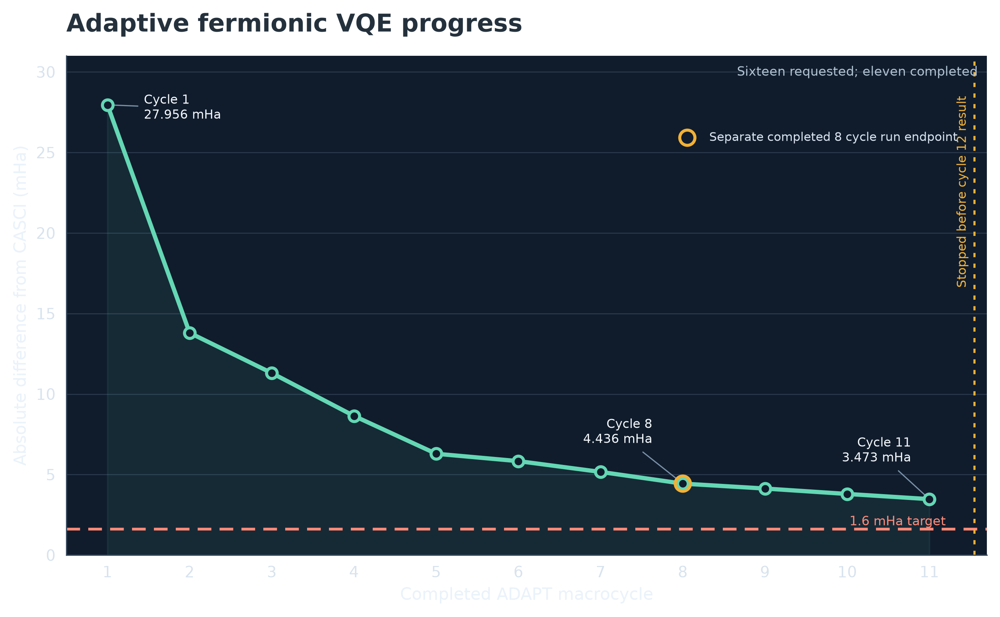
## Finite-shot simulation: why the estimate can be uncertain

The noiseless simulations calculate an energy expectation directly from the simulated quantum state. A real measurement instead samples outcomes. Each individual outcome is called a **shot**. The energy is estimated by combining many shots across the measurements needed for the molecular Hamiltonian.

With fewer shots, random sampling can make the energy estimate vary substantially. More shots can reduce this sampling uncertainty, but require more measurements.

### The saved low-shot example

This project includes one fixed PUCCSD ×1 state evaluated in a synthetic noisy Aer simulation:

| Setting or result | Value |
|---|---:|
| Shots per measurement group | 16 |
| Qubit-wise-commuting measurement groups | 276 |
| Nominal total shots | 4,416 |
| Random seeds | 1 |
| Sampled energy offset from CASCI | +789.311 mHa |
| Reported propagated sampling standard error | 570.414 mHa |
| Exact statevector error for the same fixed circuit | 8.518 mHa |

“Nominal total shots” is 16 shots multiplied by 276 groups. It describes the stated simulation setup; service-shot accounting on hardware can use a different definition.

The sampled estimate in this one realization is far from the CASCI reference, and its reported uncertainty is large. The exact statevector result for the same fixed circuit has a much smaller error. This demonstrates how finite-shot sampling can obscure the accuracy of a state that looks better when evaluated exactly.

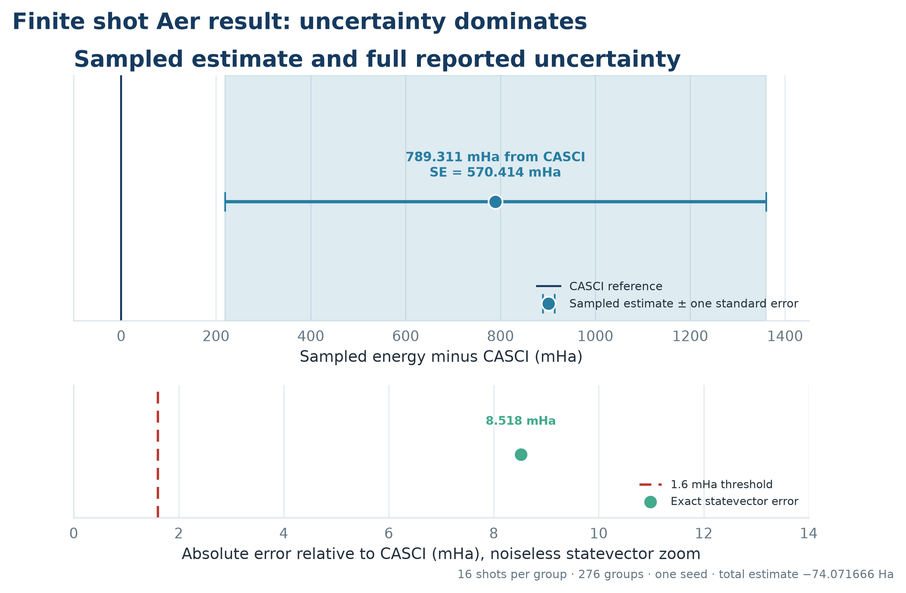

The two-scale figure makes both outcomes readable: the full panel shows the sampled offset and uncertainty, while the inset resolves the exact statevector error on its much smaller scale.

### How to interpret the standard error

A **standard error (SE)** estimates the spread expected from sampling under the stated measurement and variance model. It is not a guarantee that the exact value lies within one SE. It also does not include every possible error in the calculation.

This one-seed demonstration makes the scale of finite-shot uncertainty visible for the chosen setup. Its purpose is to illustrate estimator behavior; the number of seeds and simulator scope are stated in the limitations section.

Keep these three quantities separate:

- The **sampled offset** is how far this one sampled estimate landed from the reference.
- The **propagated SE** estimates sampling uncertainty under the specified model.
- The **exact statevector error** is the error calculated without finite-shot sampling for the same fixed circuit.

The finite-shot results are **synthetic simulation data** for the stated fixed circuit and measurement setup. Their scope is distinguished from the IBM hardware jobs in the limitations section.

## IBM hardware jobs: what was measured

The project ran four measurement jobs on IBM quantum hardware. Each job measured a **Hartree–Fock reference state** using a short circuit with four X gates and zero entangling gates.

These jobs provide real-device measurements for selected reference-state observables, with the hardware setup and job-specific results documented below. Their relationship to the optimized VQE state is specified in the limitations section.

### Recorded hardware results

Each offset below is reported relative to the ideal Hartree–Fock reference for the corresponding job. A positive offset means that the measured energy was higher, or less negative, than the reference.

| Job | Measurement description | Energy offset from ideal HF | Reported statistical SE |
|---|---|---:|---:|
| A | Full Hamiltonian; 1,079 terms and 276 measurement groups | +656.571 mHa | 346.52 mHa |
| B | Mitigated diagonal; 79 Z terms in one group, resilience level 1 with TREX twirling | +81.593 mHa | 2,140.26 mHa |
| C | Raw diagonal measurement | +296.439 mHa | 3.45 mHa |
| D | Selected-qubit diagonal measurement | +50.472 mHa | 1.47 mHa |

The four jobs explore distinct measurement definitions and settings. Job D adds a selected-qubit diagonal-observable case, complementing the full-Hamiltonian and diagonal measurements elsewhere in the set; each result is labeled by its observable and estimator.

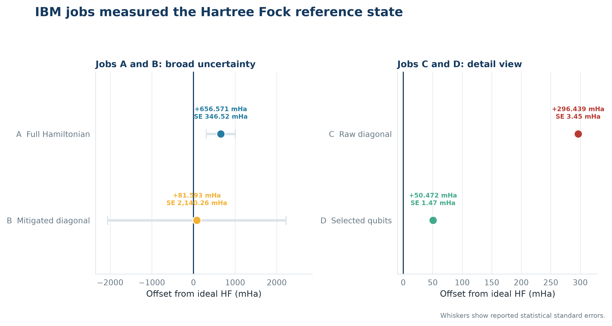

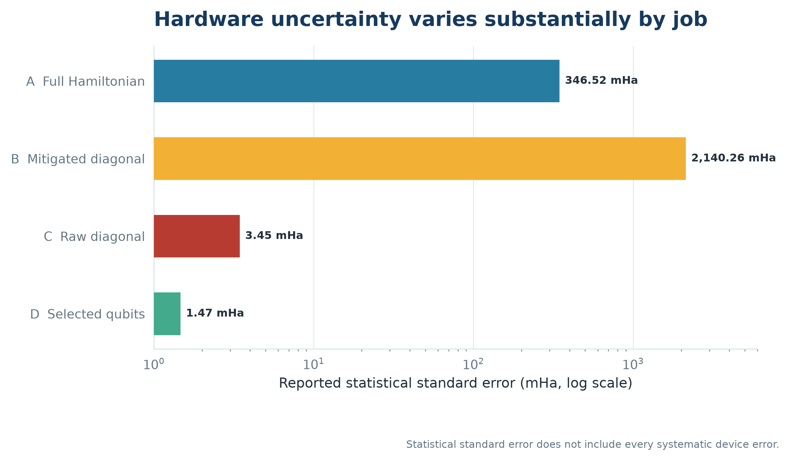

### Why Job B’s reported uncertainty is large

Job B’s diagonal measurement reports a standard error of **2,140.26 mHa**. This result highlights why uncertainty depends on the measurement procedure and estimator as well as the observable; the saved value is presented directly so readers can assess the job on its own terms.

More generally, the number of Hamiltonian terms alone does not determine the final uncertainty. The observable, measurement grouping, shot allocation, mitigation method, device behavior, and estimator all matter.

### Job D’s physical qubits and calibration snapshot

Job D used the selected physical qubits shown below. The figure also reports one calibration snapshot for those qubits.

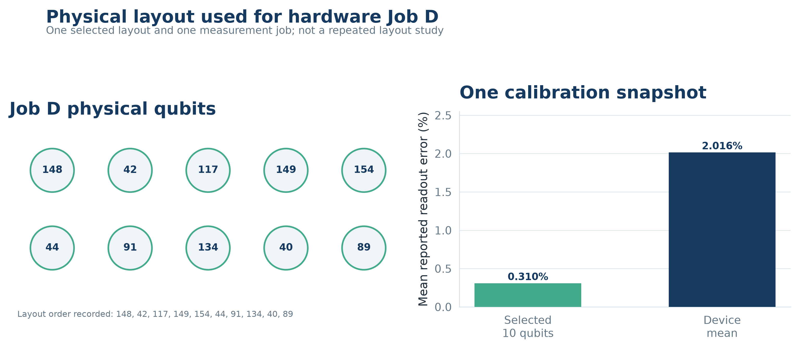

The figure documents the selected physical-qubit layout and its calibration snapshot for Job D, giving concrete context for that measurement. The limitations section records that the layout and calibration are job-specific.

### Device and execution context

The saved hardware records identify:

- Backend: **`ibm_kingston`**
- Device size in the job notes: **156 qubits**
- Calibration snapshot: **2026-10-24 20:25 UTC**
- Job interface: IBM Runtime EstimatorV2

The notes report **104 seconds of QPU time for Job A** and **21 seconds of QPU time for Job B**. Job B’s record also notes **40,000 service shots across 32 randomizations**.

QPU time is the recorded processor execution time. It is not necessarily the time a user waits from submission to result, because remote queueing and service processing can add time. “Service shots” and the nominal shots-per-group number in the finite-shot example also use different accounting contexts.

The standard errors in the table are the reported statistical errors for the jobs. They do not include every systematic device error, such as all possible state-preparation, gate, calibration, or model errors. A small reported statistical SE by itself does not establish that an energy is accurate relative to the true molecular value.

## Keep the evidence layers distinct

The project reports three kinds of evidence because each answers a different question:

| Evidence layer | State and method | What the result tells us |
|---|---|---|
| Noiseless VQE simulation | Parameterized PUCCSD or UCCSD state evaluated by ideal statevector simulation | How the saved ansatz and optimizer runs performed without finite-shot sampling or physical device noise |
| Finite-shot simulation | One fixed PUCCSD ×1 state sampled in synthetic noisy Aer | How large the sampling uncertainty was in the saved low-shot example |
| IBM hardware jobs | Hartree–Fock reference state measured with four X gates and no entangling gates | What the selected hardware jobs reported for their stated observables and settings |

Read each evidence layer according to the question it answers and the state and estimator used:

- Noiseless PUCCSD results quantify ansatz accuracy in ideal statevector simulation.
- The finite-shot Aer result isolates sampling behavior in simulation.
- The four IBM jobs characterize hardware measurements for the stated reference-state circuits.
- Job D adds a selected-qubit diagonal-observable measurement to the hardware comparison.
- Reported standard errors describe statistical uncertainty; energy offsets report differences from the stated reference.
## What the results support

The saved calculations support these specific conclusions:

- In the two-start, 150-evaluation noiseless pilot, PUCCSD ×3 had a lower median error than the tested shallower PUCCSD circuits.
- In a separate longer optimization, PUCCSD ×3 reached an error of 0.001520 mHa at the central geometry.
- At the three calculated stretched-bond lengths, the saved noiseless PUCCSD ×3 errors were all below 1.6 mHa relative to the stated CASCI reference.
- The one-seed finite-shot simulation demonstrates how sampling uncertainty can dominate the fixed circuit’s exact statevector error at low shot counts.
- The four IBM hardware jobs measured Hartree–Fock reference circuits. Their energy offsets and reported statistical errors differed by job and measurement setup.
- The interactive viewer makes the classical CASCI reference densities explorable across the three saved geometries.

These conclusions are limited to the recorded calculations, geometries, model, states, estimators, and job settings described in this README.

## What the results do not establish

The project does **not** establish:

- A quantum advantage over classical electronic-structure methods.
- Chemical accuracy for an optimized VQE state measured on IBM hardware.
- That the optimized PUCCSD state was run or measured on the IBM device.
- A universal ranking of classical optimizers.
- Accuracy at every bond length between the three saved geometries.
- A large-sample estimate of optimizer performance from two pilot starts.
- A large-sample estimate of finite-shot performance from one random seed.
- That STO-3G and CAS(8e,6o) are adequate for every chemical question about water.
- That the selected Job D qubits or calibration snapshot represent other layouts or later device calibrations.

These limits define the scope of the evidence. They are necessary to interpret the numerical results correctly.

## Reproducing the calculations

The commands below assume a local checkout of this repository and a Python environment compatible with the dependencies in `pyproject.toml`. Quantum chemistry and quantum hardware packages can have platform-specific installation requirements.

### Create and activate a virtual environment

From the repository root:

    python -m venv .venv

Activate it on Linux or macOS:

    source .venv/bin/activate

Activate it in Windows PowerShell:

    .venv\Scripts\Activate.ps1

Install the project and its declared dependencies:

    python -m pip install --upgrade pip
    python -m pip install -e .

If a specific study requires an additional dependency or configuration, consult the relevant project files before running it.

### Inspect available run options

The run scripts provide command-line options. Use their help output before starting a calculation:

    python scripts/run_ansatz_resource_study.py --help
    python scripts/run_optimizer_study.py --help
    python scripts/run_orbital_reference_audit.py --help

Run a selected study using the options appropriate to your machine and research question. Some calculations can take a long time, consume substantial compute resources, or submit jobs to a remote service. Check the script options and output location before launching a large run.

### Run project tests

    python -m pytest

The test suite checks software behavior. It does not rerun every archived quantum chemistry calculation, reproduce a remote hardware queue, or guarantee that future device calibration matches the saved record.

### Regenerate the publication figures

The project includes a figure-generation script. Inspect its available options first:

    python scripts/make_publication_figures.py --help

The script reads saved calculation outputs and writes figures. Check its configured input and output paths before regenerating, especially if you are working with a modified results directory.

### How long does it take?

Plan runtime for the specific study: it depends on the optimizer, objective-evaluation budget, simulator, CPU, dependency versions, and any remote hardware queue.

A 150-evaluation pilot is a smaller calculation than a 1,500-evaluation run. A finite-shot experiment has work associated with repeated measurements and measurement groups. A hardware submission also depends on remote queueing and service processing.

The saved hardware notes report **104 seconds of QPU time for Job A** and **21 seconds for Job B**. Those are processor execution times from the records, not end-to-end wait times from job submission to receiving the result.

The archived results do not provide a reliable, comparable wall-clock benchmark for every run. For a new run, record:

- The full command and options.
- The date and software versions.
- The machine and processor used.
- The start and finish times.
- Whether the reported duration is wall-clock, simulator, or QPU time.
- The number of objective evaluations, measurement groups, and shots where applicable.

An objective-evaluation count alone is not enough to predict runtime because different optimizers can perform different amounts of work per evaluation.

## Repository guide

| Path | Contents |
|---|---|
| `src/h2o_vqe/` | Reusable molecular setup and VQE study code |
| `scripts/` | Command-line scripts for ansatz, optimizer, audit, and figure-generation tasks |
| `config/` | Project configuration and dependency information |
| `notebooks/` | Exploratory and hardware-related notebooks |
| `docs/` | Project notes, research context, and reports |
| `results/references/` | Classical reference values and consistency checks |
| `results/ansatz/` | Ansatz comparisons and saved optimization results |
| `results/geometry-scans/` | Asymmetric O–H stretch scan results |
| `results/optimizers/` | Optimizer tuning and held-out comparison results |
| `results/simulations/finite-shot-demo/` | Saved synthetic low-shot simulation output |
| `results/hardware/` | IBM hardware job records and reports |
| `results/publication_figures/report/` | Report figures in PNG and PDF formats, plus a contact sheet |
| `results/publication_figures/analysis/` | Editable analysis figures organized by subject |
| `visualization/h2o_density/` | Density grids, interactive viewer, generator, and viewer documentation |

Active and long-running outputs are documented in `results/ACTIVE_RUNS.md`; consult it before moving or cleaning result folders so ongoing work stays intact.

## Figure gallery

The report figures are stored in both PNG and PDF format under `results/publication_figures/report/`. PNGs are convenient for viewing in a browser; PDFs are useful for documents and print layouts.

| Figure | Subject | PNG |
|---|---|---|
| 1 | Asymmetric stretch geometry and energy series | [Open Figure 1](results/publication_figures/report/fig01_geometry.png) |
| 2 | Reference energies and active-space checks | [Open Figure 2](results/publication_figures/report/fig02_reference_energies.png) |
| 3 | Calculation workflow | [Open Figure 3](results/publication_figures/report/fig03_workflow.png) |
| 4 | Noiseless ansatz accuracy | [Open Figure 4](results/publication_figures/report/fig04_ansatz_accuracy.png) |
| 5 | Accuracy compared with circuit resources | [Open Figure 5](results/publication_figures/report/fig05_accuracy_resource.png) |
| 6 | PUCCSD ×3 high-budget trials | [Open Figure 6](results/publication_figures/report/fig06_puccsd3_trials.png) |
| 7 | Error across the three bond lengths | [Open Figure 7](results/publication_figures/report/fig07_bond_scan.png) |
| 8 | Orbital and reference audit | [Open Figure 8](results/publication_figures/report/fig08_orbital_audit.png) |
| 9 | Recorded ADAPT-VQE progress | [Open Figure 9](results/publication_figures/report/fig09_adapt_history.png) |
| 10 | Held-out optimizer comparison | [Open Figure 10](results/publication_figures/report/fig10_optimizer_comparison.png) |
| 11 | Finite-shot Aer estimate and uncertainty | [Open Figure 11](results/publication_figures/report/fig11_aer_sampling.png) |
| 12 | IBM hardware energy offsets | [Open Figure 12](results/publication_figures/report/fig12_hardware_energy.png) |
| 13 | IBM hardware statistical standard errors | [Open Figure 13](results/publication_figures/report/fig13_hardware_uncertainty.png) |
| 14 | Physical-qubit layout for hardware Job D | [Open Figure 14](results/publication_figures/report/fig14_readout_layout.png) |
| 15 | Summary of the three evidence layers | [Open Figure 15](results/publication_figures/report/fig15_results_overview.png) |

[Open the figure contact sheet](results/publication_figures/report/figure_contact_sheet.png)

## Glossary

**Active space**  
A selected set of molecular orbitals and electrons treated as able to rearrange during a calculation. Other orbitals may be kept fixed.

**Ansatz**  
A chosen circuit structure with adjustable parameters. The circuit prepares the trial quantum state used in VQE.

**CASCI**  
Configuration interaction within a selected active space. In this project, the main reference is frozen-core CASCI with eight active electrons in six spatial orbitals.

**CAS(8e,6o)**  
An active space containing eight active electrons and six spatial orbitals. In this project, two core electrons are frozen.

**Chemical-accuracy threshold**  
The project uses 1.6 mHa as the conventional energy-error threshold, approximately 1 kcal/mol. Meeting this threshold for a stated model does not remove errors from the basis, active-space choice, or other modeling assumptions.

**CX gate**  
A controlled-X two-qubit gate. CX count is used here as a logical entangling-gate resource estimate after the stated level-3 transpilation. It is not necessarily the number of gates after mapping and routing onto a particular processor.

**FCI**  
Full configuration interaction within the chosen finite basis. It includes all allowed electron configurations in that basis. The saved all-electron STO-3G FCI energy is a different reference from frozen-core CASCI.

**Hartree (Ha)**  
An atomic unit of energy commonly used in electronic-structure calculations.

**Millihartree (mHa)**  
One thousandth of a Hartree: 1 mHa = 0.001 Ha.

**Objective evaluation**  
An energy value supplied to an optimizer during its search. It is a measure of optimizer evaluations, not automatically a measure of runtime or hardware shots.

**RHF**  
Restricted Hartree–Fock. A mean-field approximation that uses paired electrons in spatial orbitals.

**Shot**  
One sampled outcome from a quantum measurement. Many shots are combined to estimate an observable such as energy.

**Standard error (SE)**  
An estimate of statistical uncertainty under a stated sampling model. It does not account for every systematic, device, or modeling error.

**Statevector simulation**  
An ideal numerical simulation that tracks the quantum state and can calculate expectation values without finite-shot sampling.

**VQE**  
Variational quantum eigensolver. A hybrid approach in which a classical optimizer adjusts a parameterized quantum circuit to seek a low-energy state.

## Data and reporting conventions

- Energies are in Hartree unless a table, axis, or caption specifies another unit.
- VQE errors are absolute differences from the stated frozen-core CASCI reference unless noted otherwise.
- Hardware offsets in this README are relative to the ideal Hartree–Fock reference for the corresponding job.
- Reported CX counts are logical transpiler estimates, not hardware-routed gate counts.
- Statistical standard errors are reported for their stated measurement job and estimator. They do not represent all possible sources of error.
- Results belong to their stated geometry, basis, active space, state, estimator, and run settings.
- Values are reported only for completed, recorded calculation steps.
- The density viewer identifies its classical CASCI density grids and their calculation method.

## References and further reading

- Peruzzo et al., “A variational eigenvalue solver on a photonic quantum processor,” *Nature Communications* 5, 4213 (2014). [https://doi.org/10.1038/ncomms5213](https://doi.org/10.1038/ncomms5213)
- McArdle et al., “Variational quantum eigensolver,” *Reviews of Modern Physics* 92, 015003 (2020). [https://doi.org/10.1103/RevModPhys.92.015003](https://doi.org/10.1103/RevModPhys.92.015003)
- Tilly et al., “The Variational Quantum Eigensolver: A review of methods and best practices,” *Physics Reports* 986, 1–128 (2022). [https://doi.org/10.1016/j.physrep.2022.08.003](https://doi.org/10.1016/j.physrep.2022.08.003)
- Qiskit Nature documentation: [https://qiskit-community.github.io/qiskit-nature/](https://qiskit-community.github.io/qiskit-nature/)
- IBM Quantum documentation: [https://docs.quantum.ibm.com/](https://docs.quantum.ibm.com/)

## License and reuse

See the repository’s `LICENSE` file for the terms that apply to the code and project materials. When reusing a scientific result, include the geometry, basis set, active space, method, and reference energy so readers can identify exactly which calculation the value describes.

## AI use

AI tools assisted with coding and documentation. The authors reviewed the project’s results and explanations.
